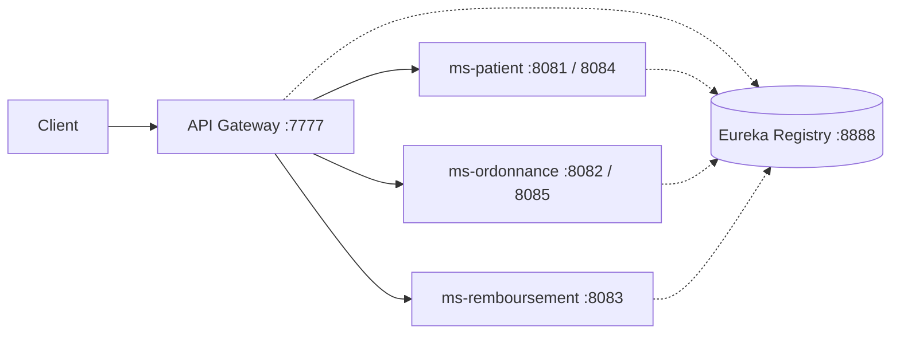

# MediLink: Healthcare Microservices Platform

A Spring Cloud microservices system that links **patients**, **prescriptions** and **reimbursements**, with service discovery, an API gateway, GraphQL/REST communication and circuit breakers.

Built from scratch, step by step, over several labs of the middleware course at ESI Sidi Bel Abbès (2025-2026): service discovery, API gateway, inter-service communication, resilience and Docker.

Course: Middleware and Services (2nd year, ESI-SBA), lab series by Dr. A. Malki.

## Architecture



Every service registers with Eureka. The gateway finds them by name (`lb://`) and load-balances between instances.

## Services

| Module | Port | Role |
|---|---|---|
| `registry` | 8888 | Eureka service discovery |
| `api-gateway` | 7777 | Single entry point, routing, circuit breakers |
| `ms-patient` | 8081 (2nd instance 8084) | Patient data |
| `ms-ordonnance` | 8082 (2nd instance 8085) | Prescriptions |
| `ms-remboursement` | 8083 | Reimbursements |
| `ms-patient-mysql` | 8091 | Patient service variant backed by MySQL |
| `ms-ordonnance-mongo` | 8092 | Prescription service variant backed by MongoDB, with a GraphQL API |

## Tech stack

Java 25, Spring Boot, Spring Cloud (Eureka, Gateway, OpenFeign), GraphQL, Resilience4j, Maven, Docker and Docker Compose, MySQL, MongoDB, H2.

## Run locally

Requirements: JDK 25 (the Maven wrapper `./mvnw` is included).

Start the registry first, then the services, then the gateway, each in its own terminal:

```bash
cd registry && ./mvnw spring-boot:run
cd ms-patient && ./mvnw spring-boot:run
cd ms-ordonnance && ./mvnw spring-boot:run
cd ms-remboursement && ./mvnw spring-boot:run
cd api-gateway && ./mvnw spring-boot:run
```

Start a second instance to see load balancing:

```bash
cd ms-patient && ./mvnw spring-boot:run -Dspring-boot.run.arguments="--server.port=8084"
```

Eureka dashboard: http://localhost:8888

## Try it

Directly:

```bash
curl http://localhost:8081/api/patient/1
curl http://localhost:8082/api/ordonnance/1
curl http://localhost:8083/api/remboursement/1
```

Through the gateway (the `/ms-xxx` prefix selects the service):

```bash
curl http://localhost:7777/ms-patient/api/patient/1
```

Example response from the reimbursement service:

```json
{"idRemboursement":2,"montant":700.0,"dateOrdonnance":"2026-02-24","nombreMedicaments":2,"nomPatient":"said"}
```

## Resilience

Each gateway route has a Resilience4j circuit breaker with a fallback endpoint (`/fallback/...`).
Configuration: sliding window of 5 calls, 50% failure threshold, 10 s in the open state.

## Docker

Each module has a `Dockerfile` that copies the built jar from `target/`, so build the jars first, then let Compose build the images and start everything:

```bash
for m in registry api-gateway ms-patient ms-ordonnance ms-remboursement; do
  (cd $m && ./mvnw -q package -DskipTests)
done
docker compose up --build
```

Only the registry (8888) and the gateway (7777) are exposed. Call the services through the gateway:

```bash
curl http://localhost:7777/ms-patient/api/patient/1
```

- `docker-compose.yml`: registry, gateway and the three services (in-memory H2).
- `docker-compose2.yml`: adds MySQL and MongoDB with the `ms-patient-mysql` and `ms-ordonnance-mongo` variants. Copy `.env.example` to `.env` and set your own values first.

## Known issues

- The gateway circuit breaker may return the fallback response even when the services are healthy. Under investigation.

## Author

Hamza Benchehida, student in Web Information Systems at ESI-SBA.
